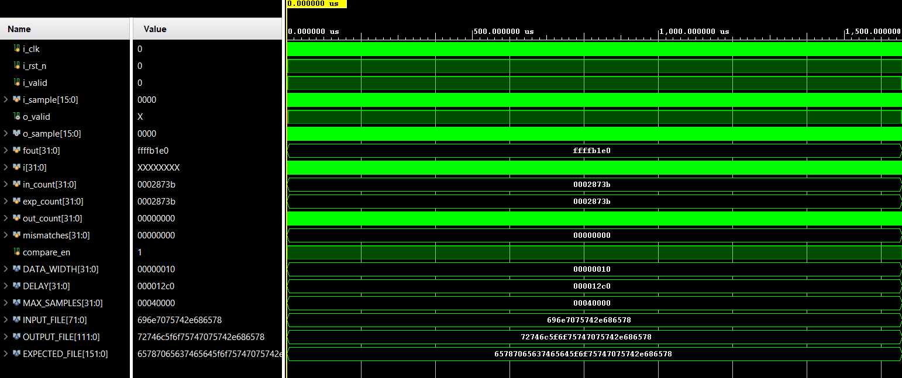
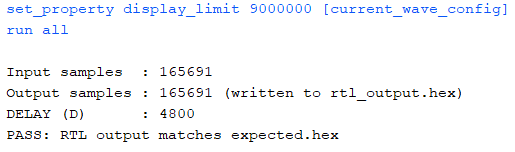

# Audio Echo

Digital echo effect for 16-bit mono audio, written in Verilog.
The design adds a delayed and halved copy of the audio to the current sample.

```text
y[n] = saturate( x[n] + 0.5 * x[n - D] )
```

---

## Overview

| Item | Description |
|---|---|
| Language | Verilog |
| Sample format | 16-bit signed, mono |
| Sample rate | 48 kHz |
| Delay D | 4800 samples (0.1 s) |
| Gain | 0.5 (shift right by 1) |
| Output | Saturated to 16-bit range |
| Golden model | Python |

---

## Design


| Module | Function |
|---|---|
| `delay_line` | Keeps the last D samples. Gives the current sample and the sample from D steps ago |
| `echo` | Halves the delayed sample, adds it to the current sample and limits the result to 16 bits |
| `echo_top` | Connects `delay_line` and `echo` |

---

## Interface


| Signal | Direction | Width | Description |
|---|---|---|---|
| `i_clk` | in | 1 | Clock |
| `i_rst_n` | in | 1 | Reset, active low |
| `i_valid` | in | 1 | Input sample is valid |
| `i_sample` | in | 16 | Input sample (signed) |
| `o_valid` | out | 1 | Output sample is valid |
| `o_sample` | out | 16 | Output sample (signed) |

Parameters: `DATA_WIDTH = 16`, `DELAY = 4800`.

---

## Repository Structure

```text
Audio_Echo/
├── data/
│   └── input/
│       ├── 16_48k_mono_test.wav
│       └── input.hex
│
├── python/
│   └── echo_golden_model.py
│
├── rtl/
│   ├── delay_line.v
│   ├── echo.v
│   └── echo_top.v
│
├── testbench/
│   ├── tb_echo_top.v
│   ├── tb_result.png
│   └── tb_waveform.png
│
├── tools/
│   ├── hex_to_wav.py
│   └── wav_to_hex.py
│
├── LICENSE
├── README.md
├── high_level_design.png
└── module_interface.png
```

---

## How to Run

1. Convert the WAV file to hex:

```bash
python tools/wav_to_hex.py
```

2. Make the expected output with the golden model:

```bash
python python/echo_golden_model.py input.hex 4800
```

3. Run `tb_echo_top.v` in the simulator. Put `input.hex` and `expected_output.hex` in the simulator working folder. The testbench sends one sample per clock, writes `rtl_output.hex` and compares it with `expected_output.hex`.

4. Convert a hex file back to WAV to listen to it:

```bash
python tools/hex_to_wav.py
```

---

## Result

| Item | Value |
|---|---|
| Input samples | 165691 |
| Output samples | 165691 |
| Delay D | 4800 |
| Mismatches | 0 |
| Result | **PASS** |




---

## License

MIT License. See [LICENSE](LICENSE).

---

## References

[1] YouTube, "What's An Echo?," [Video]. [Online]. Available: https://youtu.be/y0TyDa8PepM

[2] T. Thormählen, "Audio Effects," *Multimedia Signal Processing*, University of Marburg, June 17, 2024. [Online]. Available: https://www.mathematik.uni-marburg.de/~thormae/lectures/mmk/mmk_5_2_eng_web.html

[3] J. D. Reiss and A. P. McPherson, *Audio Effects: Theory, Implementation and Application*. Boca Raton, FL: CRC Press, 2015. [Online]. Available: https://www.routledge.com/Audio-Effects/Reissah2-McPhersonah2/p/book/9781466560284

[4] R. Schultz et al., "FPGA Implementation of Audio Effects," *EE 552 Student Application Note*, University of Alberta, 2003. [Online]. Available: https://www.ece.ualberta.ca/~elliott/ee552/studentAppNotes/2003_w/misc/Audio_Effects/FPGA-effects.pdf

[5] R. Woods, J. McAllister, G. Lightbody, and Y. Yi, *FPGA-based Implementation of Signal Processing Systems*, 2nd ed. Hoboken, NJ: John Wiley & Sons, 2017. doi: https://doi.org/10.1002/9781119079231
